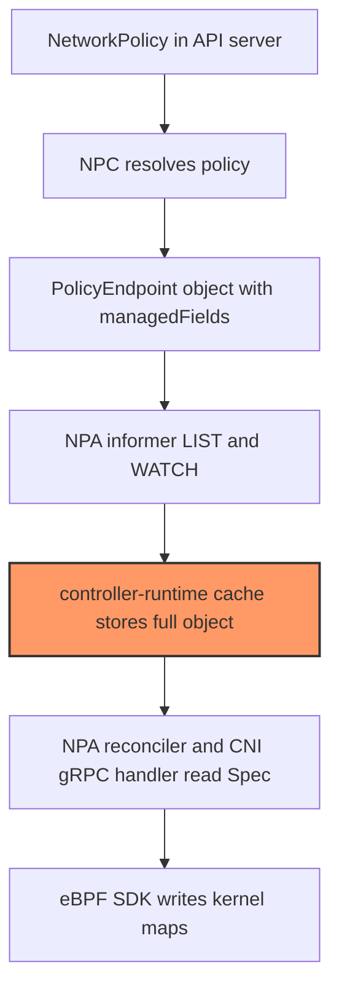
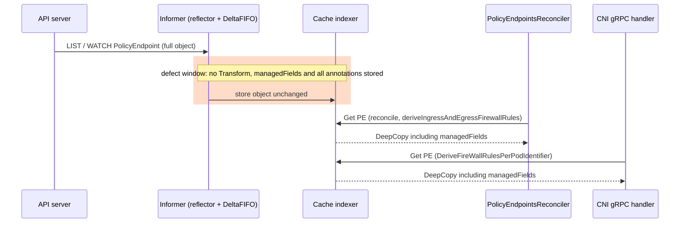
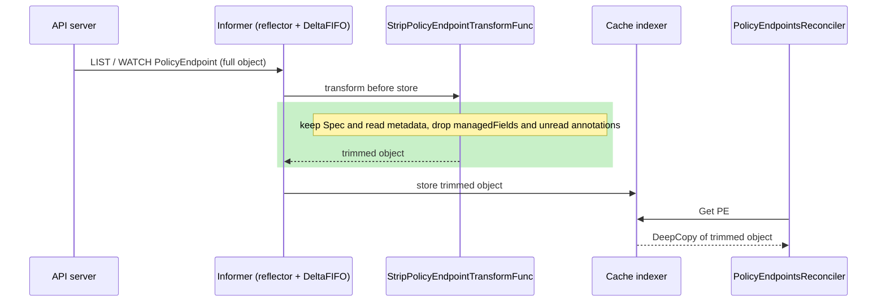
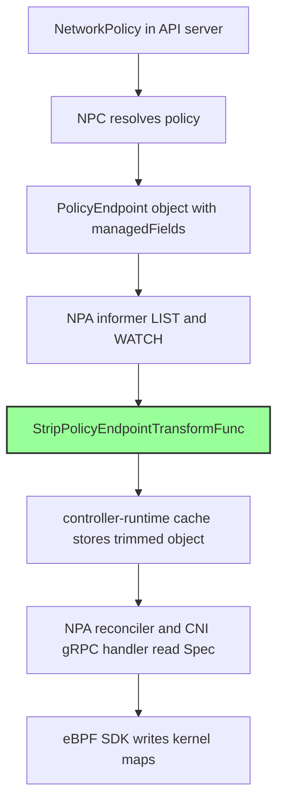

# Informer cache footprint for PolicyEndpoint objects

## 1. Problem statement

Every network policy agent keeps an in-memory copy of every PolicyEndpoint (PE) and ClusterPolicyEndpoint (CPE) in the cluster, not only the ones that select pods on its node. Each copy is stored exactly as the API server sent it. That includes `metadata.managedFields`, the bookkeeping the API server keeps for server-side apply, which the agent never reads.

In the scale benchmark, agent memory grew with the number of policies: from 240 MB to 553 MB median RSS (peak 773-878 MB) going from 5.3k to 19k policies, about 2.3x. A customer sees this as an aws-node pod whose memory request has to grow with the cluster's policy count, not with the node's own workload.

This change drops the fields the agent never reads before an object enters the cache. It removes about 0.5 KB per object (measured, section 7). That is a 40-47% cut for small or empty PEs but well under 3% for large ones. It does not remove the main cost, which is the cluster-wide Spec; that needs the agent to watch only its own node's PEs (lever NPA-15).

## 2. Root cause

(a) Cause-to-effect chain:

```
 NPC writes PE (Create / Patch)
   -> API server adds metadata.managedFields (~500 B per manager entry)
     -> agent informer LIST/WATCH receives the full object, every PE in the cluster
       -> controller-runtime default cache stores it unchanged          <-- faulty step: no Transform
         -> every cached PE carries managedFields + unread annotations
           -> agent RSS grows with cluster-wide PE count; each cache Get deep-copies the extra bytes
```

(b) Component diagram:



The highlighted step is the faulty one. The cache keeps fields that nothing downstream (F, G) ever reads.

## 3. Current behaviour



The same sequence in ASCII. Each column is an actor and time runs downward. File:line refers to `upstream/main` at `fa6fb96`.

```
 API server            Informer / DeltaFIFO                 Cache indexer           Reconciler / CNI gRPC
 ----------            --------------------                 -------------           ---------------------
 LIST/WATCH PE ------> queueActionInternalLocked
                       (client-go delta_fifo.go:490)
                       transformer == nil  [DEFECT]
                       ------------------------------------> store full PE
                                                                                    reconcile()
                                                                                    policyendpoints_controller.go:160 Get
                                                             <---------------------
                                                             DeepCopy(full PE) ---->
                                                                                    deriveIngressAndEgressFirewallRules
                                                                                    :469 Get per PE, per podIdentifier
                                                             DeepCopy(full PE) ---->
                                                                                    EnforceNpToPod -> rpc_handler.go:120
                                                                                    DeriveFireWallRulesPerPodIdentifier
                                                             DeepCopy(full PE) ---->
```

The manager is built at `main.go:92-93` from `config.BuildRuntimeOptions` (`pkg/config/runtime_config.go:66-72`), which sets no `Cache` options. The informers come from `For(&PolicyEndpoint{})` (`policyendpoints_controller.go:774`) and `For(&ClusterPolicyEndpoint{})` (`clusterpolicyendpoints_controller.go:621`).

## 4. Proposed behaviour





BEFORE | AFTER (ASCII):

```
 BEFORE                                         | AFTER
 ---------------------------------------------- | -----------------------------------------------------
 main.go:92  BuildRuntimeOptions (no Cache)     | main.go  buildManagerOptions
                                                |   opts.Cache = controllers.CacheOptions()
 API --> DeltaFIFO --> indexer                  | API --> DeltaFIFO --> StripPolicyEndpointTransformFunc
         (no transformer)                       |                       --> indexer
 cached PE: meta + managedFields + all          | cached PE: kept meta + one annotation + Spec
            annotations + Spec + Status         |
 Get: DeepCopy of all of it                     | Get: DeepCopy of kept fields only
```

Data model:

| what exists today | what changes | what stays |
|---|---|---|
| default controller-runtime cache, no Transform | `cache.Options.ByObject` for PolicyEndpoint and ClusterPolicyEndpoint with `StripPolicyEndpointTransformFunc` (`controllers/cache_transform.go`) | the informer set (PE and CPE only), resync, RBAC |
| `metadata.managedFields` in every cached object | dropped | nothing in NPA read it |
| every annotation | only `networking.k8s.aws/last-change-trigger-time` kept | `awsnodeagent_policy_programming_latency_seconds` (and the cluster-policy equivalent) |
| `status` (empty struct) | reset to the zero value | - |
| `spec` | not touched | every Spec field, verbatim |
| reconcile maps, eBPF shadow maps, kernel maps | not touched | not touched |

Preserved fields (the Transform keeps all of these):

| field | why |
|---|---|
| `spec` (all of it: PodSelector, PolicyRef, PodIsolation, PodSelectorEndpoints, Ingress, Egress; CPE: Tier, Priority, Action) | read by reconcile, rule derivation and the CNI gRPC path (`policyendpoints_controller.go:254,476,485,521,645,790`; `clusterpolicyendpoints_controller.go:190,373-399,480,585`) |
| `metadata.name`, `metadata.namespace` | cache key, Get/List, log lines |
| `metadata.deletionTimestamp` | delete path (`policyendpoints_controller.go:167`, `clusterpolicyendpoints_controller.go:125`) |
| annotation `networking.k8s.aws/last-change-trigger-time` | latency metric (`policyendpoints_controller.go:314`, `clusterpolicyendpoints_controller.go:247`) |
| `metadata.uid`, `metadata.resourceVersion` | informer and tombstone bookkeeping |
| `generation`, `creationTimestamp`, `deletionGracePeriodSeconds`, `labels`, `ownerReferences`, `finalizers` | not read today; kept because they are small and a future reader would otherwise get empty values silently |
| `TypeMeta` | untouched |

Dropped: `managedFields`, every other annotation, `generateName`, `selfLink`, `status`.

## 5. Why this fix and not the alternatives

| alternative | why rejected |
|---|---|
| `cache.TransformStripManagedFields()` as the `DefaultTransform` (drop managedFields only) | Keeps every annotation, including the client-side last-applied annotation, which can be larger than the Spec when someone applies a PE by hand or from GitOps. An allowlist of the one annotation NPA reads costs the same and closes that gap. NPC already trims pods the same way. |
| Copy Spec field by field into a slimmer struct | Silently drops any Spec field added later. Spec is the enforcement input, so it is left untouched. |
| Trim Spec too (for example, keep only local `PodSelectorEndpoints`) | Changes enforcement semantics. `podIdentifierToPolicyEndpointMap` is cluster-wide on purpose, and the reconcile maps depend on the full endpoint list. Out of scope; this is lever NPA-15 (watch only this node's PEs). |
| `UnsafeDisableDeepCopy` on reads | Removes the per-Get copy, but the reconciler and CNI paths would then share mutable cache objects. That is a correctness risk for a small GC win. |
| Put the Transform in `pkg/config` next to `BuildRuntimeOptions` | `.gitignore` line 9 (`config/`) hides new files under `pkg/config/`. The Transform lives in `controllers`, next to its readers and the annotation constant. |
| Transform PE only, leave CPE alone | Same reads, same risk, same function; leaving CPE untrimmed would be an unexplained inconsistency. |

## 6. Edge cases

| # | case | verdict |
|---|---|---|
| 1 | Transform drops a field read elsewhere (status writer, finalizer, owner-ref check, spec equality) | handled by the keep-list and an untouched Spec; covered by test `TestStripPolicyEndpoint_PreservesSpecAndReadMetadata` and `TestStripClusterPolicyEndpoint_PreservesSpecAndReadMetadata`. NPA has no status writer, finalizer, owner-ref check or spec comparison. |
| 2 | A new Spec field is added later | covered by the reflection guard in the tests (fails if the fixture leaves any Spec field zero) |
| 3 | Latency annotation alongside other annotations | handled by the allowlist; covered by test `TestStripPolicyEndpoint_ProgrammingLatencyStillObserved` |
| 4 | No annotations, only unread annotations, or an empty trigger value | covered by test `TestStripPolicyEndpoint_AnnotationEdgeCases` |
| 5 | PE being deleted | handled (DeletionTimestamp kept); covered by test PreservesSpecAndReadMetadata |
| 6 | Empty PE from NPC (zero endpoints) | covered by test `TestStripPolicyEndpoint_EmptyPEUnchangedSpec` |
| 7 | Resync or relist re-applies the Transform | handled (idempotent); covered by test `TestStripPolicyEndpoint_Idempotent` |
| 8 | Delete tombstone, other object types | passed through unchanged; covered by test `TestStripPolicyEndpoint_OtherObjectsPassThrough` |
| 9 | Real informer cache with both list+watch and watch-list protocols | covered by test `TestCacheOptions_InformerCacheHoldsStrippedObjects` |
| 10 | Manager wiring | covered by test `TestBuildManagerOptions_TrimsPolicyEndpointCache` and `TestCacheOptions_TransformsPolicyEndpointTypes` |
| 11 | Derived firewall rules and default isolation unchanged | covered by test `TestStripPolicyEndpoint_FirewallRulesUnchanged` |
| 12 | Finalizers, owner references, labels | kept; covered by test PreservesSpecAndReadMetadata |
| 13 | ClusterPolicyEndpoint Tier, Priority, Action | covered by test `TestStripClusterPolicyEndpoint_PreservesSpecAndReadMetadata` |
| 14 | Pod lifecycle races, shared pod identifiers (#671), strict-mode CNI-ADD before any PE | out of scope: the Transform changes neither event order nor Spec |
| 15 | PE chunks, no-op PE updates | out of scope: each chunk is stored with Spec intact; NPA has no spec comparison |
| 16 | Agent restart with pinned programs; kernel map full; batch syscalls | out of scope: no eBPF path changes, and nothing is persisted |
| 17 | Dual-stack entries, hostNetwork pods | out of scope: Spec data, kept verbatim |
| 18 | Relist storm after mass agent restarts | partially handled: the steady-state heap shrinks, but the transient LIST peak and network bytes are unchanged |
| 19 | New metric labels, requeue hot loops | out of scope: no metric and no error path added |
| 20 | Downgrade | out of scope: an older agent rebuilds the full cache on start |

## 7. Proof plan

Unit tests (all in `controllers/cache_transform_test.go` unless noted):
- TestStripPolicyEndpoint_PreservesSpecAndReadMetadata
- TestStripClusterPolicyEndpoint_PreservesSpecAndReadMetadata
- TestStripPolicyEndpoint_AnnotationEdgeCases
- TestStripPolicyEndpoint_EmptyPEUnchangedSpec
- TestStripPolicyEndpoint_Idempotent
- TestStripPolicyEndpoint_OtherObjectsPassThrough
- TestStripPolicyEndpoint_ProgrammingLatencyStillObserved
- TestStripPolicyEndpoint_FirewallRulesUnchanged
- TestCacheOptions_TransformsPolicyEndpointTypes
- TestCacheOptions_InformerCacheHoldsStrippedObjects
- TestBuildManagerOptions_TrimsPolicyEndpointCache (`main_test.go`)

Measured bytes per object (JSON of a realistic PE, with one managedFields entry as NPC's patch leaves it):

| PE shape | before | after | cut |
|---|---|---|---|
| empty PE | 1,098 B | 580 B | 47.2% |
| 1 endpoint, 1 rule | 1,310 B | 792 B | 39.5% |
| 10 endpoints, 10 rules | 2,885 B | 2,367 B | 18.0% |
| 100 endpoints, 100 rules | 18,815 B | 18,297 B | 2.8% |
| 1,000 endpoints | 113,683 B | 113,165 B | 0.5% |

In-cluster before/after (policy ladder, same cluster and workload; `before` is the measured baseline from the scale benchmark):

| metric | before | after | delta | n |
|---|---|---|---|---|
| agent RSS p50 at 5.3k policies | 240 MB | pending CLUSTER_OK | - | - |
| agent RSS p50 at 19k policies | 553 MB | pending CLUSTER_OK | - | - |
| agent RSS peak at 19k policies | 773-878 MB | pending CLUSTER_OK | - | - |
| managedFields entries per PE (`kubectl get pe -o json`) | not measured | pending CLUSTER_OK | - | - |
| heap in-use from the PE informer (pprof) | not measured | pending CLUSTER_OK | - | - |

Expectation, stated honestly: a single-digit-percent RSS cut at 19k policies, larger if real PEs carry several managedFields entries or many empty PEs. The 30% target is not expected from this change alone.

## 8. Operability

- **New metrics or labels:** none.
- **Log lines:** none added.
- **Behaviour:** identical in strict and standard mode. Enforcement inputs (Spec, DeletionTimestamp) are unchanged, so default-deny and default-allow decisions are the same.
- **Debugging:** objects read through the agent's cache no longer show managedFields or other annotations. Read the API server directly with kubectl to see the full object.
- **Rollback:** deploy the previous agent image. Nothing is persisted, so the next start rebuilds a full cache. No bpffs, pinned-program or `.npa_format_v2` interaction.
- **Maintenance rule:** if a reconciler starts reading another metadata field or annotation, add it to `stripObjectMeta` in `controllers/cache_transform.go`. The function comment says so, and the keep-list tests pin it.
