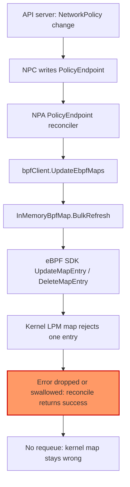
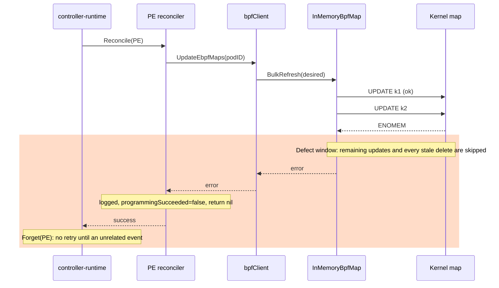
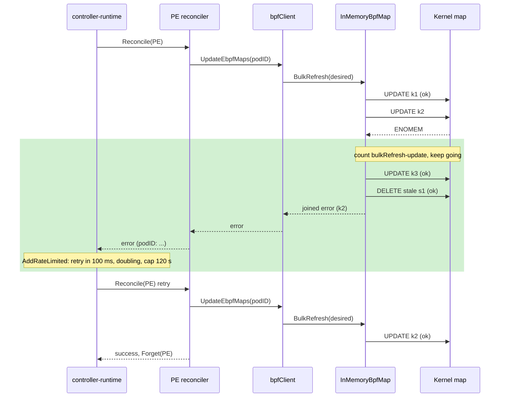
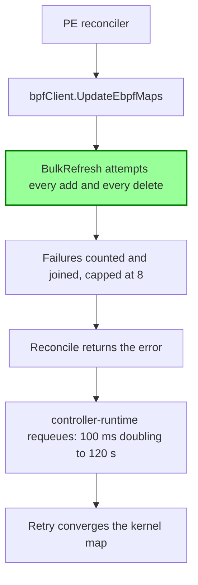

# Map write error handling

How the network policy agent reports a failed eBPF map write, and why the
PolicyEndpoint is retried until the kernel matches the policy. Related:
[#686](https://github.com/aws/aws-network-policy-agent/issues/686) and the
broader retry work in [#690](https://github.com/aws/aws-network-policy-agent/pull/690).

Terms used below:

- **PolicyEndpoint (PE)**: the per-NetworkPolicy object the network policy controller (NPC) writes and the agent (NPA) reads.
- **podIdentifier**: the key NPA uses for pods that share one set of eBPF programs and maps (the pod name without its replica suffix, plus the namespace).
- **shadow map**: `InMemoryBpfMap`, NPA's userspace copy of one kernel map, used to work out which entries to add and delete.
- **BulkRefresh**: the function that makes a kernel map match a desired entry set by issuing one update or delete syscall per changed entry.

## 1. Problem statement

When the kernel rejects a write to a pod's policy map, NPA can report success.
Then nothing retries, and the pod's traffic keeps getting the old verdict. In #686, an
ENOMEM on insert left four pods with no successful connection for 10 to 12.6
minutes, and their PolicyEndpoint was not reconciled again for 781 seconds. The
same code also drops failed deletes without reporting them, so an allow rule
that a NetworkPolicy removed can stay active in the kernel.

## 2. Root cause

```
 trigger                         defect                                   symptom
 ───────                         ──────                                   ───────
 kernel rejects one map op  ─►  BulkRefresh:                         ─►  kernel map != policy
 (ENOMEM, ENOSPC, EINVAL)        update error  → return (skips rest)
                                 delete error  → logged, dropped, nil
                                        │
                                        ▼
                                 reconcilePolicyEndpoint:            ─►  no requeue
                                 configureeBPFProbes error → logged,      (controller-runtime
                                 programmingSucceeded=false, return nil    sees success)
                                        │
                                        ▼
                                 next reconcile only on an unrelated ─►  stale ALLOW survives /
                                 PE or pod event                          new ALLOW missing for minutes
```



## 3. Current behaviour



```
 controller-runtime    PE reconciler                         bpfClient                       InMemoryBpfMap / kernel
 ──────────────────    ─────────────                         ─────────                       ───────────────────────
 Reconcile ───────────►reconcilePolicyEndpoint
                       (policyendpoints_controller.go:247)
                       configureeBPFProbes :347 ───────────► UpdateEbpfMaps
                                                             (bpf_client.go:1052)
                                                             refreshShadowMap :1396 ───────► BulkRefresh (bpf_mem_map.go:91)
                                                                                             UpdateMapEntry k2 → ENOMEM
                                                                                             return err  (:120)  ◄─ skips rest
                                                             ◄────────────────────────────── err
                       ◄──── err
                       :293 log, programmingSucceeded=false
                       :303 return nil   ◄─ swallowed
 Forget(req) ◄──────── ok
                                                                                             (delete path :132-134:
                                                                                              error logged, dropped,
                                                                                              :142 return nil)
```

The cluster-policy reconciler (`clusterpolicyendpoints_controller.go:236`)
already returns its programming error. The CNI ADD path (`rpc_handler.go:122`)
returns it to the CNI plugin. Only the namespaced PE reconciler swallowed it.
When an error *was* returned, controller-runtime's default per-item backoff
(5 ms doubling to 1000 s) could still leave a persistently failing PE waiting
longer than the 781 s outage.

## 4. Proposed behaviour



```
 BEFORE                                        | AFTER
 ──────                                        | ─────
 BulkRefresh                                   | BulkRefresh
   UPDATE k1 ok                                |   UPDATE k1 ok
   UPDATE k2 ENOMEM → return err               |   UPDATE k2 ENOMEM → sdkAPIErr{bulkRefresh-update}++, continue
   (k3 skipped, stale deletes skipped)         |   UPDATE k3 ok
                                               |   DELETE s1 ok        (sweep always runs)
   DELETE fails → logged, dropped              |   DELETE fails → sdkAPIErr{bulkRefresh-delete}++, continue
                                               |   DELETE ENOENT → treated as done
   return nil (if only deletes failed)         |   return errors.Join(first 8, "N more")
 reconcilePolicyEndpoint                       | reconcilePolicyEndpoint
   log; programmingSucceeded=false             |   log; programmingSucceeded=false; join "podIdentifier X: err"
   continue other podIDs; return nil           |   continue other podIDs; return joined error
 controller-runtime                            | controller-runtime
   Forget → never retried                      |   AddRateLimited, 100 ms → 120 s (PE and CPE controllers)
```



| what exists today | what changes | what stays |
|---|---|---|
| `InMemoryBpfMap{bpfMap, contents, mutex}` | `ops mapEntryWriter` field so tests can inject failures (nil uses the SDK map) | an entry is in the shadow only if the kernel accepted it |
| update loop stops at the first error | every add is attempted | adds run before deletes |
| failed deletes are logged and dropped | counted, returned; ENOENT counts as deleted | the shadow keeps a key whose delete failed, so the next refresh tries again |
| `sdkAPIErr{fn}` | new values `bulkRefresh-update`, `bulkRefresh-delete` | `BulkRefreshMapEntries`, `updateEbpfMap-*` |
| PE reconcile returns nil after a programming failure | returns the joined per-podIdentifier error | other podIdentifiers in the same PE are still programmed |
| default retry backoff 5 ms → 1000 s | 100 ms → 120 s for the PE and CPE controllers | per-PE backoff, reset on success, a new watch event still triggers an immediate reconcile |

## 5. Why this fix and not the alternatives

| alternative | why rejected |
|---|---|
| Keep aborting on the first update error | A full map (ENOSPC) can then never shrink, because the stale deletes that would free slots never run. The remaining valid adds are also delayed. |
| Run deletes first, then adds | When a broad allow is replaced by a narrower one, there is a window where traffic the new policy allows is dropped, even when nothing fails. Add-then-delete keeps today's no-failure behaviour. |
| Skip the delete sweep when an add failed | Leaves a revoked allow in place, which is the security bug this change fixes. With the sweep, a partial refresh errs toward deny, and the retry restores the missing allow. |
| Return `ctrl.Result{RequeueAfter}` with a nil error (#690's approach) | Needs a per-PE attempt map and its own cleanup. A capped rate limiter gives the same bounded schedule with no new state, and keeps `controller_runtime_reconcile_errors_total` meaningful. |
| Keep the default rate limiter | Its 1000 s cap is longer than the 781 s outage in #686. |
| Retry ENOMEM inside BulkRefresh | Real fix for the kernel >= 6.13 allocator race, but it needs a sleep budget while holding the per-pod lock on the CNI ADD path. Left to #690. This change is complementary. |
| Classify errnos with `errors.Is` | The SDK formats the errno as text (`%s`), so `errors.Is` cannot see it. One string match for ENOENT is the minimum needed. |

## 6. Edge cases

| case | verdict |
|---|---|
| 1-of-N delete fails | handled by the delete sweep; test `TestBulkRefresh_OneOfNDeleteFails` |
| 1-of-N update fails (ENOMEM #686) | handled; `TestBulkRefresh_UpdateENOMEMPropagated` |
| partial apply: add fails, stale deletes pending | handled; `TestBulkRefresh_AddFailureStillRunsDeletes` |
| kernel map full (ENOSPC) | handled; `TestBulkRefresh_ENOSPCRecoversOnRetry` |
| delete ENOENT | handled by `isNotExist`; `TestBulkRefresh_DeleteENOENTIsSuccess` |
| every operation fails | handled by the 8-error cap; `TestBulkRefresh_ErrorsCapped` |
| permanent errno → hot requeue loop | handled by the capped limiter; `TestProgrammingRateLimiter_BoundedBackoff`, `TestProgrammingRateLimiter_ForgetResets` |
| reconciler swallowed the error | handled; `TestReconcilePolicyEndpoint_MapWriteErrorRequeues` |
| one failing podIdentifier blocks the others | handled; same test |
| no change needed | no syscall; `TestBulkRefresh_NoChangeNoSyscall` |
| pod deleted before programming completes | out of scope: path unchanged, `deletedPods` guard and capped retry bound it |
| pod with no selecting policy / strict CNI ADD before any PE | out of scope: no map write |
| identity collision (#671), first vs Nth pod | out of scope: keying unchanged |
| PE sliced across chunks | out of scope: the union is computed before BulkRefresh |
| agent restart with populated maps | handled by the existing kernel hydration (`loadFromKernel`) |
| batched syscalls, partial apply | out of scope: no batch ops yet, and a future batch path must keep these semantics |
| dual-stack | handled: the loop does not depend on key format |
| informer relist storm | handled: per-PE capped retry, no API writes |
| metrics cardinality | two fixed new label values |

## 7. Proof plan

Unit tests (all in this change): `TestBulkRefresh_OneOfNDeleteFails`,
`TestBulkRefresh_UpdateENOMEMPropagated`, `TestBulkRefresh_AddFailureStillRunsDeletes`,
`TestBulkRefresh_ENOSPCRecoversOnRetry`, `TestBulkRefresh_DeleteENOENTIsSuccess`,
`TestBulkRefresh_ErrorsCapped`, `TestBulkRefresh_NoChangeNoSyscall`,
`TestReconcilePolicyEndpoint_MapWriteErrorRequeues`,
`TestProgrammingRateLimiter_BoundedBackoff`, `TestProgrammingRateLimiter_ForgetResets`.
A mutation check removed each core change in turn, and each removal made at
least one of these tests fail.

In-cluster before/after (fault injection with a test image that fails one
`DeleteMapEntry` / returns ENOMEM on one update):

| metric | before | after | delta | n |
|---|---|---|---|---|
| reconcile retried after map write failure | no (#686: next reconcile after 781.4–782.2 s) | pending CLUSTER_OK | | |
| connection outage after one ENOMEM | 10–12.6 min (#686) | pending CLUSTER_OK | | |
| stale ALLOW entry after failed delete (`bpftool map dump`) | present, 0 errors reported (expected) | pending CLUSTER_OK | | |
| `awsnodeagent_aws_ebpfsdk_error_count{fn="bulkRefresh-delete"}` | series does not exist | pending CLUSTER_OK | | |

## 8. Operability

- **Metrics**: `awsnodeagent_aws_ebpfsdk_error_count{fn="bulkRefresh-update"}` and `{fn="bulkRefresh-delete"}` count each failed entry. `{fn="BulkRefreshMapEntries"}` still counts once per failed refresh. Since the error now reaches controller-runtime, `controller_runtime_reconcile_errors_total{controller="policyendpoint"}` also increments on a failed PE reconcile.
- **Logs**: up to 8 lines per refresh, `update|delete kernel map entry <hex key>: <sdk error>`. The summary line adds `failed N`, and the reconciler logs `Reconcile error: podIdentifier <id>: ...`. The SDK still logs each failed syscall itself.
- **Retry schedule**: per PolicyEndpoint and ClusterPolicyEndpoint, 100 ms doubling to 120 s, reset after a successful reconcile. A watch event still triggers an immediate reconcile.
- **Strict vs standard mode**: no mode-specific code. Strict mode stays deny by default until the retry succeeds. Standard mode now converges on retry instead of keeping the last state. A partial refresh errs toward deny, never toward an allow the policy removed.
- **Rollback**: revert the commit. There are no on-disk or map format changes, so up- and downgrades are safe.
